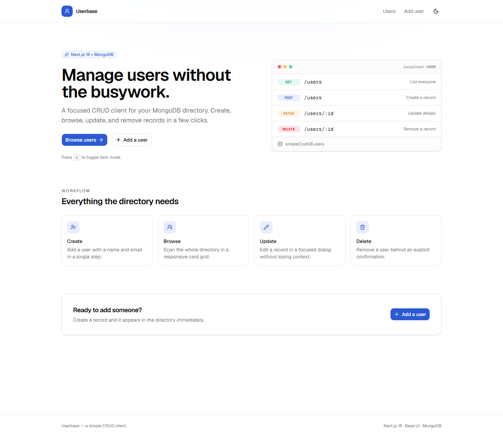
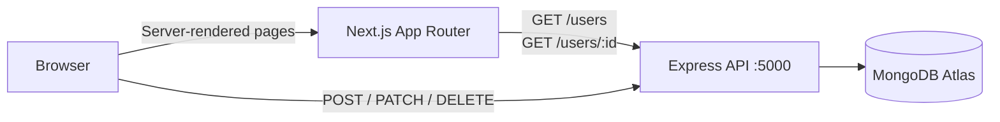

# Userbase

A full-stack CRUD application for managing a MongoDB-backed user directory. The frontend is a server-rendered Next.js App Router app; the backend is a small Express API that talks to MongoDB Atlas.

**Live app:** [mongo-db-crud-operations.vercel.app](https://mongo-db-crud-operations.vercel.app)  
**API:** [mongo-db-crud-api.vercel.app](https://mongo-db-crud-api.vercel.app)



## Overview

Userbase lets you browse every user in the directory, create new records, edit names and emails, and delete users with an explicit confirmation step. The interface includes loading skeletons, empty and error states, a custom 404 page, and a light/dark theme.

The repository contains both halves of the application:

- **`simple-crud-client`** — Next.js 16 frontend. Server components read from the API; forms and dialogs call it directly from the browser.
- **`simple-crud-server`** — Express 5 API backed by the MongoDB Node.js driver.

## Features

- Responsive directory with initials avatars, user counts, and card-based records
- Create, edit, and delete flows with pending states and inline errors
- Confirmation dialog before deleting a user
- Loading skeletons, empty state, error boundary, and custom 404 page
- Live data on `/users` and `/users/[userId]` — no rebuild needed after mutations
- Light and dark themes with a header toggle or the `d` shortcut
- Keyboard-accessible controls, visible focus rings, and semantic form labels

## Tech stack

| Area      | Technology                                                     |
| --------- | -------------------------------------------------------------- |
| Framework | Next.js 16.4 (App Router, Turbopack)                           |
| UI        | React 19.3, Base UI 1.9, shadcn/ui (`base-nova`), lucide-react |
| Styling   | Tailwind CSS 4.3, `class-variance-authority`, `cn`             |
| Theming   | `next-themes`                                                  |
| Language  | TypeScript 5                                                   |
| API       | Express 5 + MongoDB Node.js driver                             |
| Database  | MongoDB Atlas — `simpleCrudDB.users`                           |
| Quality   | ESLint 9, Prettier 3                                           |

## Architecture



- `/users` and `/users/[userId]` fetch from the API with `cache: "no-store"`; `/users` also sets `export const dynamic = "force-dynamic"`.
- Mutations run in client components and call the API directly. After success they use `router.refresh()` (create redirects to `/users`), so the server-rendered data updates.
- The API URL defaults to `http://localhost:5000` and can be overridden with `NEXT_PUBLIC_API_URL`. There are no Next.js route handlers or server actions.

## Project structure

```text
.
├── simple-crud-client/
│   ├── app/
│   │   ├── layout.tsx              Root layout, header, footer, metadata
│   │   ├── page.tsx                Landing page
│   │   ├── error.tsx               Route error boundary with retry
│   │   ├── not-found.tsx           404 page
│   │   ├── globals.css             Tailwind v4 theme tokens and base styles
│   │   └── users/
│   │       ├── page.tsx            User directory (dynamic)
│   │       ├── loading.tsx         Directory skeleton
│   │       ├── new/page.tsx        Create-user form
│   │       └── [userId]/
│   │           ├── page.tsx        User detail (dynamic)
│   │           └── loading.tsx     Detail skeleton
│   ├── components/
│   │   ├── ui/                     shadcn/Base UI primitives
│   │   ├── site-header.tsx         Brand, navigation, theme toggle
│   │   ├── UserCard.tsx            Directory card
│   │   ├── UpdateUserDialog.tsx    Edit form dialog
│   │   └── delete-user-button.tsx  Delete confirmation flow
│   ├── lib/                        API config, shared types, and `cn` re-export
│   ├── .env.example                Client API URL template
│   └── docs/screenshot.png         Screenshot used in this README
└── simple-crud-server/
    ├── index.js                    Express API and MongoDB connection
    ├── .env.example                Required credential template
    └── .env                        Local credentials (gitignored)
```

`simple-crud-client/hooks` and `simple-crud-client/public` are currently unused.

## Getting started

### Prerequisites

- Node.js **22 or newer** (the `cn` package requires it; Next.js requires 20.9+)
- npm
- Access to the MongoDB Atlas cluster referenced in `simple-crud-server/index.js`; the cluster host is hard-coded, while `DB_USER` and `DB_PASS` come from `.env`

Each package has its own dependencies. There is no root `package.json` or workspace, so run `npm install` in both directories.

### 1. Start the API

```bash
cd simple-crud-server
npm install
```

Copy `.env.example` to `.env` and fill in the MongoDB Atlas credentials:

```dotenv
DB_USER=your_mongodb_user
DB_PASS=your_mongodb_password
```

The server reads `DB_USER` and `DB_PASS`, connects to MongoDB Atlas, and serves the `simpleCrudDB` database and `users` collection. It listens on `PORT` or **5000** and enables CORS for browser requests.

```bash
npm run dev   # node --watch
# or
npm start     # node index.js
```

The `.env` file is gitignored.

### 2. Start the client

```bash
cd simple-crud-client
npm install
npm run dev
```

Open [http://localhost:3000](http://localhost:3000). No client-side `.env` file is required; the API defaults to `http://localhost:5000`. To use another host, copy `.env.example` to `.env.local` and set `NEXT_PUBLIC_API_URL`.

### Run both services

Use two terminals:

```bash
# Terminal 1
cd simple-crud-server && npm run dev

# Terminal 2
cd simple-crud-client && npm run dev
```

## Deploying to Vercel

Deploy the two packages as **two Vercel projects** from this repository. Vercel auto-detects Next.js and Express, so no `vercel.json` is required.

1. **Create the API project first.** Import the repo, set **Root Directory** to `simple-crud-server`, and add `DB_USER` and `DB_PASS` under Project Settings → Environment Variables for Production (and Preview if needed). Deploy and note the URL, for example `https://userbase-api.vercel.app`.
2. **Create the client project.** Import the same repo, set **Root Directory** to `simple-crud-client`, and add `NEXT_PUBLIC_API_URL` with the API URL from step 1 (no trailing slash). Deploy.
3. **Allow Atlas access.** In MongoDB Atlas, add `0.0.0.0/0` to Network Access (Vercel Functions use dynamic egress IPs), or use a fixed egress/private-link setup.
4. **Redeploy the client after changing `NEXT_PUBLIC_API_URL`.** The value is inlined at build time.

The server exports its Express app and only calls `app.listen` outside Vercel, so the same `index.js` works locally and as a Vercel Function. `NEXT_PUBLIC_API_URL` must point at the deployed API; otherwise the production build falls back to `http://localhost:5000` and the pages fail.

If you would rather have one project and one domain, the alternative is to move the Express routes into Next.js Route Handlers under `simple-crud-client/app/api/` and remove the separate server package. That is a larger refactor because `API_BASE_URL` is also used by server components.

## Configuration

| Variable              | Package              | Required | Description                                       |
| --------------------- | -------------------- | -------- | ------------------------------------------------- |
| `DB_USER`             | `simple-crud-server` | Yes      | MongoDB Atlas database user                       |
| `DB_PASS`             | `simple-crud-server` | Yes      | MongoDB Atlas database password                   |
| `PORT`                | `simple-crud-server` | No       | API port; defaults to `5000`                      |
| `NEXT_PUBLIC_API_URL` | `simple-crud-client` | No       | API base URL; defaults to `http://localhost:5000` |

Set `NEXT_PUBLIC_API_URL` in `simple-crud-client/.env.local` to point at another API host. The value is inlined at build time, so rebuild after changing it in production. The fallback lives in `simple-crud-client/lib/api.ts`.

## API contract

Requests use `application/json`. Missing users return `404`, invalid IDs return `400`, and errors use a JSON body such as `{ "error": "User not found." }`.

| Method   | Endpoint     | Purpose                   | UI relies on                             |
| -------- | ------------ | ------------------------- | ---------------------------------------- |
| `GET`    | `/users`     | List all users            | Array of user records                    |
| `GET`    | `/users/:id` | Get one user              | A user record; `404` for a missing ID    |
| `POST`   | `/users`     | Create a user             | `acknowledged` from a 2xx response       |
| `PATCH`  | `/users/:id` | Update `name` and `email` | Successful HTTP status; `404` if missing |
| `DELETE` | `/users/:id` | Delete a user             | `deletedCount`; `404` if missing         |

The frontend treats any non-2xx response as a failure. A missing or invalid user ID displays the 404 page.

### Data model

```ts
interface User {
  _id: string // MongoDB ObjectId, serialized as a string
  name: string
  email: string
}
```

The API requires a non-empty `name` and `email`; it does not enforce a stricter schema. The client also marks both form fields as required.

## Available scripts

Run these from `simple-crud-client`:

| Command             | Description                                                      |
| ------------------- | ---------------------------------------------------------------- |
| `npm run dev`       | Start the development server at `http://localhost:3000`          |
| `npm run build`     | Create a production build                                        |
| `npm run start`     | Serve the production build                                       |
| `npm run lint`      | Run ESLint with the Next.js core-web-vitals and TypeScript rules |
| `npm run typecheck` | Run `tsc --noEmit`                                               |
| `npm run format`    | Format all `.ts` and `.tsx` files with Prettier                  |

Recommended verification order before committing:

```bash
npm run lint
npm run typecheck
npm run build
```

Run these from `simple-crud-server`:

| Command       | Description                        |
| ------------- | ---------------------------------- |
| `npm run dev` | Start the API with `node --watch`  |
| `npm start`   | Start the API with `node index.js` |

There is currently no automated test suite.

## Routes

| Route             | Rendering | Description                                                 |
| ----------------- | --------- | ----------------------------------------------------------- |
| `/`               | Static    | Landing page with an overview of the CRUD workflow          |
| `/users`          | Dynamic   | User directory with count, add action, and card grid        |
| `/users/new`      | Client    | Form for creating a user                                    |
| `/users/[userId]` | Dynamic   | User profile with contact details, edit, and delete actions |

## Design conventions

- The UI uses shadcn/ui's `base-nova` style with **Base UI**, not Radix. Compose triggers with the `render` prop (for example, `<DialogTrigger render={<Button />} />`); `asChild` is not available.
- Add new primitives with `npx shadcn@latest add <component>`; they are placed in `components/ui`.
- Tailwind CSS v4 has no `tailwind.config.*`. Theme tokens and base styles live in `app/globals.css`.
- `cn` comes from the `cn` package (`lib/utils.ts` only re-exports it). When styling a `<Link>` as a button, wrap the result: `cn(buttonVariants(...))`. The raw variant string contains conflicting border classes, which can hide the border on outline links.
- The theme is class-based via `next-themes`. Click the header toggle or press `d` outside an input, textarea, select, or content-editable element.
- Formatting is handled by Prettier with no semicolons, double quotes, LF line endings, and automatic Tailwind class sorting.

## Troubleshooting

| Symptom                                  | Likely cause and fix                                                                          |
| ---------------------------------------- | --------------------------------------------------------------------------------------------- |
| "Something went wrong" error page        | The API is unreachable. Start the backend and confirm `http://localhost:5000/users` responds. |
| A user detail page shows 404             | The record was deleted or the ID does not exist.                                              |
| The directory is empty                   | The `users` collection has no documents. Use **Add user** to create one.                      |
| Port 3000 is already in use              | Run `npm run dev -- -p 3001` and open that port instead.                                      |
| Port 5000 is already in use              | Set `PORT` in the server environment before starting it.                                      |
| Server exits immediately on startup      | Check that `DB_USER` and `DB_PASS` are set correctly in `simple-crud-server/.env`.            |
| Code changes do not appear in production | Rebuild with `npm run build` and restart `npm run start`.                                     |
| Theme does not switch with `d`           | The shortcut is ignored while typing in a form control; use the header toggle.                |

## Known limitations

- CORS is enabled for all origins, and there is no authentication or rate limiting.
- The directory has no search, sorting, or pagination.
- There is no automated test suite; verification is lint, typecheck, build, and manual checks.
- The project is designed for a single `users` collection.

## License

No license file is included in this repository. Add one before distributing or reusing the project.
