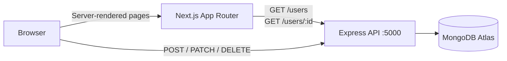

# Userbase

A clean, responsive CRUD interface for managing a MongoDB-backed user directory. Built with the Next.js App Router, React 19, Tailwind CSS v4, and Base UI.


## Overview

Userbase is the front end for a small user directory. It lets you browse every record, add a new user, edit existing details, and delete users with an explicit confirmation. The interface includes loading skeletons, empty and error states, a custom 404 page, and a light/dark theme.

The app is a client for a separate Express + MongoDB API. It does not contain API routes or server actions; server components read data from the API, while forms and dialogs call it directly from the browser.

## Features

- Responsive directory with initials avatars, user counts, and card-based records
- Create, edit, and delete flows with pending states and inline errors
- Confirmation dialog before deleting a user
- Loading skeletons, empty state, error boundary, and custom 404 page
- Light and dark themes with a header toggle or the `d` shortcut
- Keyboard-accessible controls, visible focus rings, and semantic form labels
- Live data in `/users` and `/users/[userId]` — no rebuild needed after mutations

## Tech stack

| Area      | Technology                                                     |
| --------- | -------------------------------------------------------------- |
| Framework | Next.js 16.4 (App Router, Turbopack)                           |
| UI        | React 19.3, Base UI 1.9, shadcn/ui (`base-nova`), lucide-react |
| Styling   | Tailwind CSS 4.3, `class-variance-authority`, `cn`             |
| Theming   | `next-themes`                                                  |
| Language  | TypeScript 5                                                   |
| API       | Express 5 + MongoDB Node.js driver (separate service)          |
| Database  | MongoDB Atlas — `simpleCrudDB.users`                           |
| Quality   | ESLint 9, Prettier 3                                           |

## Architecture



- `/users` and `/users/[userId]` fetch from the API with `cache: "no-store"`; `/users` also sets `export const dynamic = "force-dynamic"`.
- Mutations run in client components and call the API directly. After success they use `router.refresh()` (or navigate back to the list), so the server-rendered data updates.
- The API URL is hard-coded. There are no environment variables, Next.js route handlers, or server actions in this repo.

## Getting started

### Prerequisites

- Node.js **22 or newer** (`cn` requires Node 22; Next.js requires 20.9+)
- npm (bundled with Node.js)
- The companion Express API running on port 5000
- Access to the MongoDB database used by that API

### 1. Start the API

The backend is a separate repository. In the original workspace it lives at `../simple-crud-server`; if you only have this repository, you will need that service or a compatible API implementing the contract below.

```bash
cd ../simple-crud-server
npm install
```

Create a `.env` file with the MongoDB credentials:

```dotenv
DB_USER=your_mongodb_user
DB_PASS=your_mongodb_password
```

Then start the server:

```bash
node index.js
```

The backend has no `dev` or `start` npm script. It listens on `PORT` or **5000**, connects to the `simpleCrudDB` database, and enables CORS for browser requests.

### 2. Start the client

```bash
npm install
npm run dev
```

Open [http://localhost:3000](http://localhost:3000). No client-side `.env` file is required.

To point the client at a different API host, update the hard-coded `http://localhost:5000` fetch URLs in:

- `app/users/page.tsx`
- `app/users/[userId]/page.tsx`
- `app/users/new/page.tsx`
- `components/UpdateUserDialog.tsx`
- `components/delete-user-button.tsx`

Also update the display-only references in `app/page.tsx` and `app/error.tsx`.

## Available scripts

| Command             | Description                                                      |
| ------------------- | ---------------------------------------------------------------- |
| `npm run dev`       | Start the development server at `http://localhost:3000`          |
| `npm run build`     | Create a production build                                        |
| `npm run start`     | Serve the production build                                       |
| `npm run lint`      | Run ESLint with the Next.js core-web-vitals and TypeScript rules |
| `npm run typecheck` | Run `tsc --noEmit`                                               |
| `npm run format`    | Format all `.ts` and `.tsx` files with Prettier                  |

Recommended verification order before committing:

```bash
npm run lint
npm run typecheck
npm run build
```

There is currently no automated test suite.

## Routes

| Route             | Rendering | Description                                                 |
| ----------------- | --------- | ----------------------------------------------------------- |
| `/`               | Static    | Landing page with an overview of the CRUD workflow          |
| `/users`          | Dynamic   | User directory with count, add action, and card grid        |
| `/users/new`      | Client    | Form for creating a user                                    |
| `/users/[userId]` | Dynamic   | User profile with contact details, edit, and delete actions |

## API contract

Requests use `application/json`. The API returns JSON objects or arrays, except for a missing user, which may come back as an empty `200` response.

| Method   | Endpoint     | Purpose                   | UI relies on                                    |
| -------- | ------------ | ------------------------- | ----------------------------------------------- |
| `GET`    | `/users`     | List all users            | Array of user records                           |
| `GET`    | `/users/:id` | Get one user              | A user record or an empty body for a missing ID |
| `POST`   | `/users`     | Create a user             | `acknowledged`                                  |
| `PATCH`  | `/users/:id` | Update `name` and `email` | Successful HTTP status                          |
| `DELETE` | `/users/:id` | Delete a user             | `deletedCount`                                  |

The front end treats any non-2xx response as a failure. A missing or invalid user ID displays the 404 page.

### Data model

```ts
interface User {
  _id: string // MongoDB ObjectId, serialized as a string
  name: string
  email: string
}
```

The Express API does not enforce a schema; the client marks both form fields as required.

## Project structure

```text
app/
  layout.tsx              Root layout, header, footer, metadata
  page.tsx                Landing page
  error.tsx               Route error boundary with retry
  not-found.tsx           404 page
  globals.css             Tailwind v4 theme tokens and base styles
  users/
    page.tsx              User directory (dynamic)
    loading.tsx           Directory skeleton
    new/page.tsx          Create-user form
    [userId]/
      page.tsx            User detail (dynamic)
      loading.tsx         Detail skeleton

components/
  site-header.tsx         Brand, navigation, theme toggle
  page-header.tsx         Shared page heading and actions
  user-avatar.tsx         Initials avatar
  empty-state.tsx         Empty directory state
  delete-user-button.tsx  Delete confirmation flow
  UserCard.tsx            Directory card
  UpdateUserDialog.tsx    Edit form dialog
  theme-provider.tsx      next-themes provider and `d` shortcut
  ui/                     shadcn/Base UI primitives

lib/
  types.ts                Shared User type
  utils.ts                `cn` re-export

docs/
  screenshot.png          Landing page preview used in this README
```

`hooks/` and `public/` are present but currently unused.

## Design and conventions

- The UI uses shadcn/ui's `base-nova` style with **Base UI**, not Radix. Compose triggers with the `render` prop (for example, `<DialogTrigger render={<Button />} />`); `asChild` is not available.
- Add new primitives with `npx shadcn@latest add <component>`; they are placed in `components/ui`.
- Tailwind CSS v4 has no `tailwind.config.*`. Theme tokens and base styles live in `app/globals.css`.
- `cn` comes from the `cn` package (`lib/utils.ts` only re-exports it). When styling a `<Link>` as a button, wrap the result: `cn(buttonVariants(...))`. The raw variant string contains conflicting border classes, which can hide the border on outline links.
- The theme is class-based via `next-themes`. Click the header toggle or press `d` outside an input, textarea, select, or content-editable element.
- Formatting is handled by Prettier with no semicolons, double quotes, LF line endings, and automatic Tailwind class sorting.

## Troubleshooting

| Symptom                                  | Likely cause and fix                                                                          |
| ---------------------------------------- | --------------------------------------------------------------------------------------------- |
| "Something went wrong" error page        | The API is unreachable. Start the backend and confirm `http://localhost:5000/users` responds. |
| A user detail page shows 404             | The record was deleted or the ID does not exist.                                              |
| The directory is empty                   | The `users` collection has no documents. Use **Add user** to create one.                      |
| Port 3000 is already in use              | Run `npm run dev -- -p 3001` and open that port instead.                                      |
| Port 5000 is already in use              | Set `PORT` in the backend environment before starting it.                                     |
| Code changes do not appear in production | Rebuild with `npm run build` and restart `npm run start`.                                     |
| Theme does not switch with `d`           | The shortcut is ignored while typing in a form control; use the header toggle.                |

## Known limitations

- The API base URL is hard-coded rather than configured through an environment variable.
- There is no authentication, authorization, request validation, or rate limiting.
- The directory has no search, sorting, or pagination.
- There is no automated test suite; verification is lint, typecheck, build, and manual checks.
- The project is designed for a single `users` collection.

Natural next steps would be extracting a configurable API client, adding tests, and introducing search and pagination.

## License

No license file is included in this repository. Add one before distributing or reusing the project.
